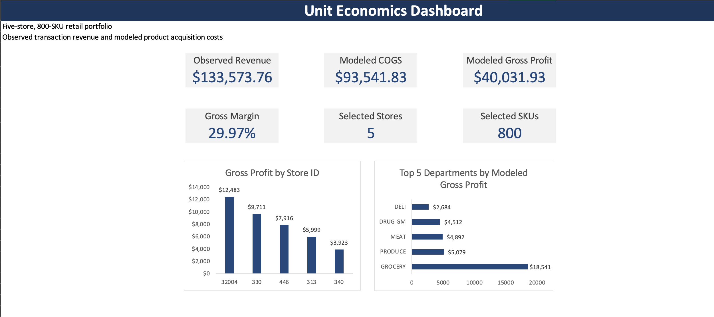
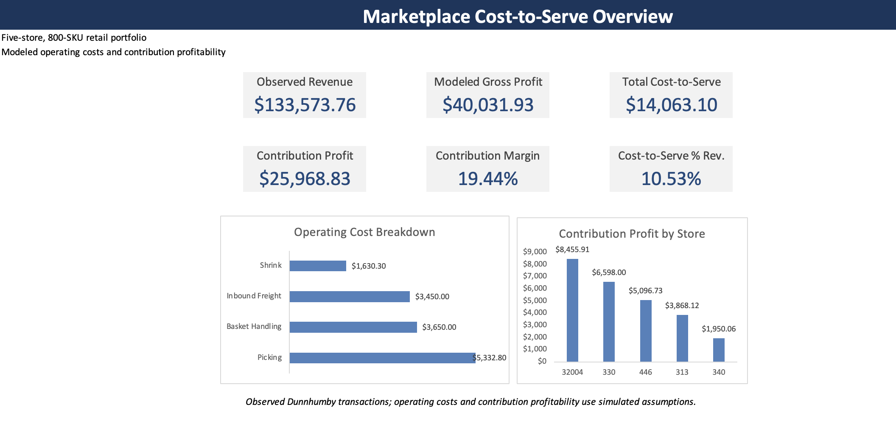
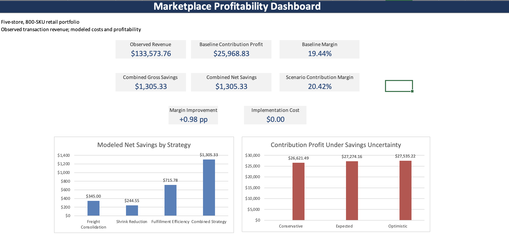
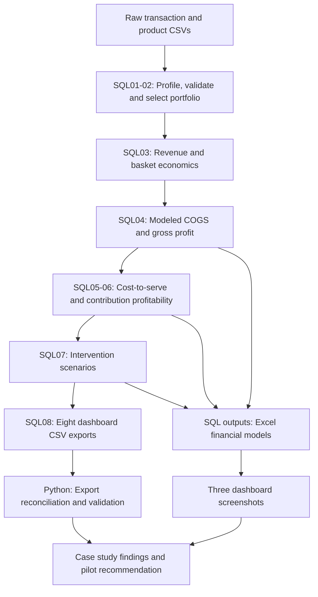

# Marketplace Economics & Profitability Analytics

**A retail profitability case study using DuckDB SQL, Python and Excel.**

## Project summary

This project investigates how product acquisition costs and operating costs affect retail contribution profitability—and which cost-reduction opportunities deserve further testing. It connects observed Dunnhumby Complete Journey transactions to an illustrative financial model, three Excel dashboards and reproducible dashboard exports.

The selected portfolio contains **five stores, 800 SKUs and 44,595 transaction lines**. Observed revenue of **$133,573.76** produces **$25,968.83 modeled contribution profit (19.44%)** under the stated assumptions. A combined operating-cost scenario increases modeled margin to **20.42%**, with **$1,305.33 gross savings** before implementation costs.

> Revenue is observed; acquisition costs, operating costs and savings are modeled. Results describe the selected household transaction sample, not complete store financials or realized business improvements.

[Dashboards](#dashboards) · [Business questions](#business-questions) · [Workflow](#analytical-workflow) · [Findings](#key-findings) · [Challenges](#challenges-and-how-the-model-addresses-them) · [Improvements](#opportunities-for-improvement) · [Reproduce](#reproduce-the-analysis)

## Dashboards

The images below are snapshots of the Excel dashboards. Open an image to inspect it at full resolution, or download its workbook to explore the model.

### 1. Unit economics

Observed revenue, modeled acquisition costs and gross profit establish the baseline before operating expenses. Store and department comparisons show where gross profit is concentrated.

[](outputs/figures/01_unit_economics_dashboard.png)

[Open the unit economics workbook](excel/01_unit_economics_model.xlsx)

### 2. Cost-to-serve and contribution profitability

Freight, picking, basket handling and shrink reduce gross profit to contribution profit. Picking is the largest modeled operating-cost component; the store comparison shows contribution dollars across the selected sample.

[](outputs/figures/02_cost_to_serve_dashboard.png)

[Open the cost-to-serve workbook](excel/02_cost_to_serve_model.xlsx)

### 3. Profitability scenarios

Four interventions compare potential savings, while sensitivity cases vary the realization of combined savings. The displayed implementation-cost assumption is $0, so modeled gross and net savings are equal in this reference case.

[](outputs/figures/03_profitability_scenarios_dashboard.png)

[Open the profitability scenarios workbook](excel/03_profitability_scenarios.xlsx)

*Rounding note: the screenshot shows $27,274.16 for expected contribution profit; the SQL export reports $27,274.15 using unrounded intermediate values. The case-study tables below use SQL results. Screenshots are static and do not automatically refresh when SQL or workbook inputs change.*

## Business questions

- How much observed revenue remains after modeled acquisition and operating costs?
- Which stores, departments and SKUs warrant closer profitability review?
- Which operating-cost components offer the largest modeled savings opportunities?
- How sensitive are the results to savings realization and implementation costs?
- What evidence would be needed before recommending an operational rollout?

## Data and analytical scope

| Scope | Definition |
|---|---|
| Source | Dunnhumby Complete Journey household transaction data, obtained through Kaggle |
| Primary inputs | `transaction_data.csv` and `product.csv` |
| Store selection | One store from each of five revenue tiers, after activity and coverage screening |
| Product selection | Top 800 eligible SKUs by observed revenue across the five stores |
| Exclusions | Null departments, `KIOSK-GAS` and `MISC SALES TRAN` |
| Final population | 44,595 transaction lines across five stores and 800 SKUs |
| Revenue coverage | 38.25% of eligible retail sales; 35.88% of all observed five-store sales |
| Time basis | Observed sample period using relative dataset days; results are not annualized |

Selection prioritizes an interpretable portfolio with transaction coverage. It is not a random sample or a claim of representativeness across all stores. The exact Kaggle download URL and dataset version still need to be recorded for source traceability.

## Analytical workflow



The Excel models use the financial outputs from the earlier SQL stages. SQL08 provides a consolidated dashboard export layer; it does not automatically refresh the workbooks or screenshots.

### Financial model

```text
Observed revenue − Modeled COGS = Modeled gross profit
Modeled gross profit − Cost-to-serve = Modeled contribution profit
Cost-to-serve = Freight + Picking + Allocated basket handling + Shrink
Net scenario savings = Gross scenario savings − Implementation costs
```

COGS uses SKU reference unit prices and department cost ratios. Freight is charged on nonnegative recorded units; picking applies to positive-quantity or positive-sales lines. Shared handling is allocated using eligible revenue in the complete observed store/basket, including products outside the selected portfolio. Shrink is a department-specific share of modeled COGS.

See [financial assumptions](docs/financial_assumptions.md) for rates, exception handling and formulas.

## Key findings

### Baseline economics

| Metric | SQL result |
|---|---:|
| Observed revenue | $133,573.76 |
| Modeled COGS | $93,541.83 |
| Modeled gross profit | $40,031.93 |
| Modeled cost-to-serve | $14,063.10 |
| Modeled contribution profit | $25,968.83 |
| Modeled contribution margin | 19.44% |

Operating costs consume 10.53% of observed revenue. Picking contributes $5,332.80 of modeled cost-to-serve, followed by basket handling ($3,650.00), inbound freight ($3,450.00) and shrink ($1,630.30). This makes fulfillment effort a useful starting point for further investigation under the current assumptions.

### Scenario comparison

| Scenario | Illustrative intervention | Gross savings | Contribution profit | Margin |
|---|---|---:|---:|---:|
| Baseline | No change | $0.00 | $25,968.83 | 19.44% |
| Freight consolidation | Freight cost −10% | $345.00 | $26,313.83 | 19.70% |
| Shrink reduction | Shrink cost −15% | $244.55 | $26,213.37 | 19.62% |
| Fulfillment efficiency | Picking −10%; handling −5% | $715.78 | $26,684.61 | 19.98% |
| Combined strategy | All three interventions | $1,305.33 | $27,274.15 | 20.42% |

**Fulfillment efficiency is the largest standalone modeled opportunity.** The combined strategy improves margin by approximately **0.98 percentage points**. Revenue, product mix and COGS remain unchanged in these scenarios; savings are additive and exclude implementation costs. Displayed amounts are independently rounded.

The sensitivity cases apply 50%, 100% and 120% realization to combined gross savings. They are illustrative assumptions, not statistical confidence intervals or probability-weighted forecasts.

## Recommended next business step

Run a small fulfillment-efficiency pilot after replacing the most important assumptions with operating evidence. Establish a consistent baseline, select comparable pilot and comparison operations, and account for differences in order volume and product mix.

Measure picking cost per qualifying line, handling cost per basket, service accuracy, stock availability and shrink. Include implementation and recurring costs when estimating net savings. Scale only if measured savings persist without unacceptable service deterioration. No pilot has been conducted as part of this project.

## Challenges and how the model addresses them

| Analytical challenge | Approach used | Remaining limitation |
|---|---|---|
| Transaction data does not contain actual procurement or operating costs | Separate observed revenue from explicit department and activity-based cost assumptions | Modeled profitability needs validation against actual costs |
| Non-retail categories distort the intended scope | Review departments, exclude gas and miscellaneous sales, then re-rank eligible SKUs | The selected 800 SKUs cover only part of observed retail sales |
| Zero-sales or zero-quantity lines complicate unit economics | Retain scoped lines, estimate reference prices from positive sales/quantity, and apply defined fallback rules | Recorded units are not standardized physical quantities across products |
| Shared basket costs can be overstated for a partial portfolio | Allocate handling against complete eligible observed basket revenue | The $0.60 handling rate remains hypothetical |
| Different aggregation levels can produce misleading totals | Preserve row grain, aggregate dollars before calculating margins, and validate grouped results | Distinct SKU counts and scenario populations must not be summed indiscriminately |
| Rounding can create apparent SQL/Excel discrepancies | Preserve unrounded SQL intermediate values and round at export | Workbook calculations using rounded inputs can differ by a cent |

## Opportunities for improvement

| Priority | Improvement | Value to the analysis |
|---|---|---|
| 1 | Replace assumed COGS, labor, freight and shrink with operational records | Establish whether the opportunity ranking holds with actual costs |
| 2 | Estimate implementation and recurring costs over a consistent period | Evaluate net savings, break-even points and investment trade-offs |
| 3 | Test alternative store/SKU selections and time periods | Assess selection bias, stability and seasonality |
| 4 | Vary cost assumptions as well as savings realization | Identify which uncertain inputs most affect the recommendation |
| 5 | Automate workbook refresh and snapshot generation | Reduce manual updates and keep published visuals aligned with exports |
| 6 | Record the exact source version and pin environment dependencies | Improve reproducibility for another analyst |

## Validation and limitations

The SQL08 validator checks export presence and uniqueness, financial identities, source revenue and line counts, grouped financials, cost components, scenario savings, combined-savings additivity, sensitivity cases and the filtered SKU leakage population. It passed against the local project database; a deliberately altered revenue value in a separate test export correctly caused validation to fail.

Validation establishes consistency with the current database. It does not establish the accuracy of assumed costs, independently audit every Excel formula or demonstrate realized savings.

Additional interpretation limits:

- Source transactions represent participating households, not complete store operations.
- Contribution profit excludes fixed facilities, corporate overhead, last-mile delivery and payment processing; it is not net profit.
- Scenarios hold demand, revenue and product mix constant and do not model intervention interactions.
- SKU margin leakage is a filtered diagnostic of up to 40 products, not an additive portfolio total.
- The analysis is independent, is not affiliated with DoorDash and does not use its internal financial records.

## Reproduce the analysis

With the existing DuckDB database and virtual environment, run from the project root:

```sh
.venv/bin/python scripts/run_sql.py sql/08_dashboard_exports.sql
.venv/bin/python scripts/validate_08_exports.py
```

Successful validation prints `SQL08 DASHBOARD EXPORT CHECKS PASSED`. SQL08 writes eight `08_*.csv` files in `outputs/tables/` without changing persistent database tables or views.

For environment setup, required raw inputs and the exact SQL01–08 execution order, follow the [methodology](docs/methodology.md). Raw CSVs and the local DuckDB database are intentionally excluded from Git and must be supplied separately for a full rebuild.

## Repository guide

| Location | Contents |
|---|---|
| [`sql/`](sql/) | Profiling, scope selection, revenue, unit economics, operating costs, profitability, scenarios and dashboard exports |
| [`scripts/`](scripts/) | SQL runner and SQL08 validation |
| [`excel/`](excel/) | Three financial-model and dashboard workbooks |
| [`outputs/figures/`](outputs/figures/) | Dashboard screenshots embedded above |
| [`outputs/tables/`](outputs/tables/) | SQL results and eight consolidated dashboard exports |
| [`docs/`](docs/) | Supporting case-study documentation |

## Supporting documentation

- [Executive summary](docs/executive_summary.md): recommendation, pilot and interpretation limits.
- [Methodology](docs/methodology.md): scope selection, calculation sequence and reproduction.
- [Financial assumptions](docs/financial_assumptions.md): cost ratios, operating rates and scenarios.
- [Data dictionary](docs/data_dictionary.md): source fields, relationships, export grains and metric definitions.

## Skills demonstrated

SQL joins, window functions and analytical aggregation; financial modeling with explicit assumptions; allocation of shared costs; scenario and sensitivity analysis; Python reconciliation checks; Excel dashboard communication; and translating modeled findings into a measurable business pilot.
